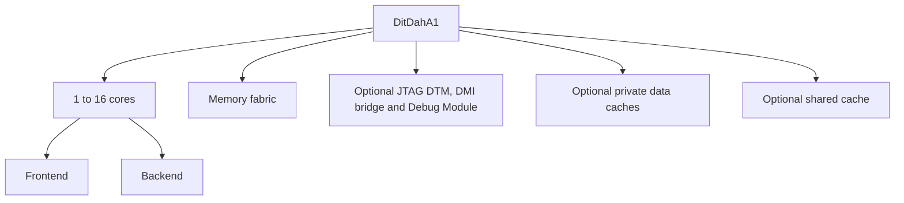

# DitDah-A1

DitDah-A1 is a configurable 64-bit RISC-V processor with up to sixteen coherent harts.
It uses an eight-stage, in-order pipeline with one to three issue lanes.

## Features

| Component | Current implementation |
| --- | --- |
| ISA | RV64I/Zicsr/Zifencei with optional M/A/C/F/D and standard scalar extensions |
| Execution | Independent integer ALUs can follow one ordinary load/store; instructions using other resources issue alone |
| Privilege | M, optional M/U or M/S/U; Bare or Sv39/Svade |
| Protection | Zero or sixteen PMP entries per hart, including internal memory and device paths |
| Memory | Private instruction/data caches, CPU data coherence, optional 128 KiB shared cache |
| Interfaces | AXI4 with 64/128/256/512-bit data; optional system-level JTAG Debug 1.0 subset |

The default uses one single-issue, M-mode hart with M/A, Bare addressing, and no caches, PMP, interrupts or JTAG.
Atomic accesses require a qualified memory region and end-to-end exclusive monitoring.
Sv48, H and vector execution are not implemented. RVA23S64 remains a target.
Linux and FPGA operation have not been validated.

Module hierarchy:



See the [system top](ditdah_a1/src/DitDahA1.scala), [core](ditdah_a1/src/DitDahA1Core.scala) and [parameters](ditdah_a1/src/DitDahA1Parameter.scala).

## Build

Use Nix with flakes enabled. Run these commands from the repository root:

```bash
nix develop
make config
make check
configure-ditdah-a1 --rtl --config result/ditdah_a1_config.json --output result/checked.json
build-ditdah-a1 --config result/checked.json --output result/rtl
```

`result/rtl` contains SystemVerilog, `filelist.f` and the selected configuration in `ditdah_a1_config.json`.
`make rtl` independently generates the default configuration; it does not read the output of `make config`.
Software and external-debug tests need additional tools listed in [Verification](doc/verification.md).

## Configuration and integration

Edit the generated configuration's `parameters` object, then pass the file explicitly with `--config`.
Without `--rtl`, the configuration command checks the parameter schema, which also describes unimplemented target values.
The builder validates the selected system or component before generating RTL.

[Configuration](doc/configuration.md) documents supported values, memory requirements, fault behavior and integration contracts.
System JTAG needs an explicit `jtagIdcode` and `debugBase`; attached AXI peers must follow the `systemResetActive` reset domain.
With `enableJtag`, standalone Core and Backend builds expose a debug execution interface instead of JTAG pins.

## Verification

```bash
make verify-simulation  # scalar and multicore RTL checks
make verify-signoff     # full hardware verification campaign
```

The campaign includes software, protocol checks, formal properties and negative controls; its runtime depends on configuration and workload.
See [Verification](doc/verification.md) for prerequisites, individual gates, reports and acceptance limits.
These checks do not establish full ISA compliance, RVA23 conformance or physical signoff.

## License

Project code uses [MIT](LICENSE); the arithmetic library retains BSD-3-Clause notices. See [REUSE.toml](REUSE.toml).

## Credits

- [CHIPS Alliance Rocket](https://github.com/chipsalliance/rocket-chip): processor architecture and configurable hardware design.
- [CHIPS Alliance T1](https://github.com/chipsalliance/t1): hardware generation and verification workflows.
- [DitDah-E1](https://github.com/vowstar/ditdah-e1): project structure and reproducible configuration workflow.
- [Zaozi](https://github.com/xinpian-tech/zaozi): hardware description framework and pinned development tools.
- [RISC-V specifications](https://riscv.org/specifications/ratified/): instruction and privilege contracts.
- [LLVM](https://github.com/llvm/llvm-project), [CIRCT](https://github.com/llvm/circt) and [YosysHQ](https://github.com/YosysHQ): compiler and verification tools.
- [Berkeley HardFloat](https://www.jhauser.us/arithmetic/HardFloat.html): IEEE 754 arithmetic.
- [RISC-V architectural tests](https://github.com/riscv-non-isa/riscv-arch-test), [Sail](https://github.com/riscv/sail-riscv), [RVFI instruction models](https://github.com/YosysHQ/riscv-formal) and [herdtools7](https://github.com/herd/herdtools7): architectural and memory-model checks.
- [Zephyr](https://github.com/zephyrproject-rtos/zephyr): multicore software tests.
